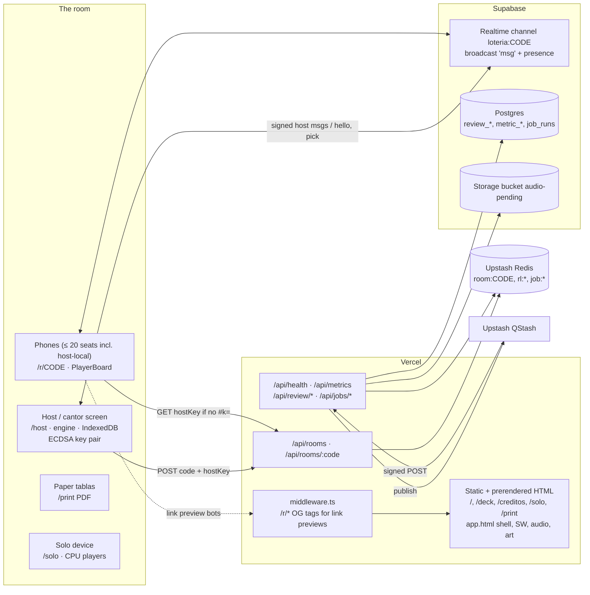

# Architecture

This document describes the system as it stands in v1.0, checked against the code. The network contract is in [protocol.md](protocol.md) and the game rules are in [rules.md](rules.md). Anything marked _unverified_ could not be confirmed from the repo.

## 1. Shape of the system

The app is a static **Vite + React 19 PWA** with a few **Vercel Functions** in `api/`. The browser does all the game work: shuffling the deck, deriving tablas, choosing the spelling choices, scoring, playing audio and building PDFs. The **host device** (the cantor screen) is the only authority for a room. Phones join a **Supabase Realtime** channel (broadcast + presence). There is no game server and no game database.

During play, only one Function matters: `/api/rooms`, the room-code and host-key registry in **Upstash Redis**. The Postgres, Storage and QStash parts serve a reviewer and metrics pipeline. Their endpoints are deployed, but no current client calls them.

## 2. Vercel surface

**Static and prerendered.** `pnpm build` writes `dist/`. These routes are prerendered to real HTML: `/`, `/deck`, `/creditos`, `/solo`, `/print` and `404.html`. `dist/app.html` is the noindexed SPA shell. `vercel.json` rewrites `/host`, `/r/:code` and `/ui` to `/app.html` and sends `X-Robots-Tag: noindex, nofollow` on those routes. `robots.txt` disallows the same routes plus `/api/`. Cache headers: `/assets`, `/art` and `/fonts` are immutable for one year, `/og` gets 7 days plus SWR, and `/sw.js` is `no-cache`.

**Middleware** (`middleware.ts`, matcher `/r/:path*`). Link-preview bots don't run JS, so for GET/HEAD the middleware fetches `/app.html`. It strips the generic title, description, OG, Twitter and canonical tags and injects invite-specific ones: title `¡Te invitaron a la Lotería! · Sala CODE`, image `/og/invite.png`, `noindex`. The response is cached with `s-maxage=3600`. If anything fails, the request passes through to the normal rewrite.

**Functions** (`api/`, Node runtime). Every handler goes through `route()` in `api/_lib/http.ts`, which provides a method guard, same-origin only (no CORS headers; a foreign `Origin` gets 403) and `{"error":code}` bodies. A missing service answers `503 {"error":"not_configured","feature"}`.

| Route                      | Method | Does                                                                                                                                                                         | Called by           |
| -------------------------- | ------ | ---------------------------------------------------------------------------------------------------------------------------------------------------------------------------- | ------------------- |
| `/api/rooms`               | POST   | Takes `{code, hostKey}` and runs `SET room:CODE hostKey NX EX 14400` (4 h). Returns 201 when new and 200 when the same key is already stored (resume). A different key gets 409 `code_taken`. Limit 10/min per IP. | host (`useHostRoom`) |
| `/api/rooms/:code`         | GET    | Returns `{hostKey}` or 404, with `no-store`. Limit 60/min per IP.                                                                                                              | host (409 check), phones without `#k=` |
| `/api/health`              | GET    | Returns `{redis, qstash, db}`, each `ok`, `not_configured` or `error`.                                                                                                        | ops                 |
| `/api/metrics`             | POST   | Takes up to 50 anonymous counters (`round_start`, `card_matched`, `claim`, `round_end`, `print`) and inserts them into `metric_events`. With `DNT`/`Sec-GPC` it stores nothing and returns 204. Limit 30/min per IP. | **no client yet**   |
| `/api/review/auth`         | POST   | Checks `{lang, code}` against `REVIEW_CODE` (timing-safe) and returns a 2-hour HMAC token. Only failures count: 5 per IP and 50 globally per 10 min.                          | **no client yet**   |
| `/api/review/submit`       | POST   | Requires a Bearer token. Inserts into `review_submissions` (idempotency key), can return a signed upload URL into `audio-pending`, and enqueues `notify-reviewers`. Limit 20 per 10 min per IP. | **no client yet**   |
| `/api/review/uploaded`     | POST   | Checks that the upload exists in Storage, then enqueues `transcode-recording`.                                                                                                | **no client yet**   |
| `/api/jobs/notify-reviewers` | POST | QStash only. Stub: writes a `job_runs` row.                                                                                                                                  | QStash              |
| `/api/jobs/transcode-recording` | POST | QStash only. Sets the submission from `upload_pending` to `uploaded`. No ffmpeg runs.                                                                                     | QStash              |
| `/api/jobs/rollup-metrics` | POST   | QStash only. Rolls `metric_events` up into `metric_daily` for complete UTC days and deletes raw rows older than 30 days. _Unverified:_ whether a QStash schedule exists.        | QStash schedule     |
| `/api/jobs/publish-content-release` | POST | QStash only. Stub.                                                                                                                                                       | manual              |

Every job (`api/_lib/job.ts`) does the same things. It verifies `Upstash-Signature` over the raw body and the public URL. It takes a Redis lease `job:{jti}` (`NX EX 120`, then `done` for 24 h) and writes `job_runs`. On failure it releases the lease and returns 5xx so QStash retries.

**Data actually stored.** In Redis: `room:CODE`, the `rl:*` rate-limit counters and `job:*`. In Postgres (`supabase/migrations/0001_init.sql`, RLS on with no policies, so only the service role can read or write): `review_submissions`, `metric_events`, `metric_daily` and `job_runs` are written by code. `reviewers`, `review_decisions` and `content_releases` exist, but no code touches them. In Storage: a private `audio-pending` bucket. **No player data is stored anywhere**: no names, tablas or marks.

## 3. Client module map

Path aliases (`vite.aliases.ts`): `@engine`, `@net`, `@content`, `@print`, `@ai`, `@app`.

| Module        | What it is                                                                                                                                                                                                                                                                                       |
| ------------- | ----------------------------------------------------------------------------------------------------------------------------------------------------------------------------------------------------------------------------------------------------------------------------------------------- |
| `src/engine`  | Pure, deterministic rules with no I/O. `deckOrder(seed, roundNo, ids)`, `tabla(seed, index, cards)` (4×4, ≤ 5 per category), `pickTablaIndex` (≤ 8 shared cards), `choicesFor(seed, roundNo, i, correct, pool, exclude)`, `scorePick` (2/1/0, ≤ 2 picks per call), `resolveFullCardWinners`, `tablaCode`/`decodeTablaCode` (6-char Crockford code with a GF(32) check), `roomCode` (5 chars, no I/L/O/0/1), `checkClaim`/`PATTERNS` (only the loadtest and `validateSeatClaim` use these), `soloCpuPick`. Room limits: `ROOM_MIN_PLAYERS = 2`, `ROOM_MAX_PLAYERS = 20`. |
| `src/net`     | `Transport` interface. `BaseTransport` adds the send queue (≤ 100 before join), generation guards and the `Session`, which validates with zod, signs and verifies, and applies rate limits. Two transports: `LocalTransport` (`BroadcastChannel loteria:CODE` with its own presence heartbeat, 2 s beat and 6 s expiry) and `SupabaseTransport` (Realtime channel `loteria:CODE`, broadcast event `msg`, `self: false`, presence key = seat, track `{role}`). `createTransport()` uses Supabase when `VITE_SUPABASE_URL` and `VITE_SUPABASE_ANON_KEY` are set, otherwise Local. Host messages are signed with **ECDSA P-256** over a versioned envelope containing the message and a durable sequence number. Players pin the key from the QR `#k=` or `/api/rooms`, or else use **trust-on-first-use** (TOFU). See [protocol.md](protocol.md). |
| `src/content` | `cards.json`: 54 cards in 6 categories. Each card has an emoji `art` and names in es/en/nah/yua/quz with a review status, IPA and sources; all 270 are `approved` and all have audio. zod `schema.ts`, `callableLangs()` (`VITE_HIDE_UNREVIEWED`), `isAvoidedPair` (distractor exclusions), UI string catalogues, `credits.json`. |
| `src/ai`      | `hint.ts`: offline tag-matcher hint provider, used by the player and solo boards. There is no online provider.                                                                                                                                                                                       |
| `src/print`   | PDF tablas built with `pdf-lib` + fontkit in a Web Worker (`worker.ts`). Layout, seeds and options. Each tabla carries its 6-char check code.                                                                                                                                                                  |
| `src/app`     | React Router routes (`routes.tsx`): `/` home, `/host`, `/r/:code` join → lobby → player game, `/solo`, `/print`, `/deck`, `/creditos`, `/ui` (component gallery), `*` 404. Areas: `home`, `host` (`useHostRoom`: code, keys, registry, roster, presence; `useGame`: automatic caller and scoring; `roundMachine`; `persist` in IndexedDB), `join`, `lobby` (`LobbyWaiting`: hello/retry), `player` (`playerState` reducer, `PlayerBoard`, `WinScreen`), `game` (`HostGame`, `PlayerGame` boundary), `solo` (`soloEngine`: local host + CPUs), `audio` (`speakCall`), `print`, `deck`, `credits`, `ui` (shared components), `theme` (tokens, preferences), `seo` (head/meta and the SSR entry used by prerender), `i18n.ts` (es/en UI via i18next + ICU). |

**Audio.** `speakCall(card, lang)` plays the card's recorded `.m4a` (`public/audio/{lang}/{id}.m4a`). If there is no clip, es/en fall back to Web Speech and Indigenous languages return `no-audio`; they never use speech synthesis at runtime. The 270 active clips are generated offline: Kokoro for es/en and Meta MMS-TTS for nah/yua/quz. See [audio.md](audio.md). The host screen starts muted. Each phone plays the call in its own spoken language.

## 4. Offline and PWA

`vite-plugin-pwa` with `registerType: 'autoUpdate'` generates the service worker.

- **Precached:** everything in `dist` matching `js, css, html, svg, png, webp, jpg, json, webm, m4a, woff2, ttf` under 3 MB per file. That covers the app shell, the prerendered pages, all 270 audio clips, art, fonts and OG images. `public/` itself is about 4 MB. `navigateFallback` is `/index.html`; the client always mounts with `createRoot`, so any route renders offline. `/api/*` is `NetworkOnly` and is excluded from the fallback.
- **Works offline:** `/solo` (the engine drives the cantor and CPU players on-device), `/print` (PDFs built in a worker), `/deck` and `/creditos`, and the **host** game. If the transport can't connect, the host shows "offline" but keeps calling, scoring and saving to IndexedDB. Paper players can play along. Phones need the network unless they share a browser with the host (LocalTransport).
- **Host persistence:** IndexedDB `loteria-host` has three stores. `state` holds the saved round (settings, seed, call count, assignments, pick state and the roster with tabla indexes). `keys` holds one non-extractable ECDSA key pair per room code, so a reload keeps the same `hostKey`. `assignments` also exists.

## 5. Build pipeline

1. `tsc -b` then `vite build`: client bundle with sourcemaps, plus the PWA manifest and service worker.
2. `scripts/prerender.mjs`. It writes `dist/app.html` (the built shell, noindexed, without canonical or OG URL). It bundles `src/app/seo/ssr-entry.tsx` with Vite SSR and renders each public route with `react-dom/server` into the shell under jsdom. It applies per-route head tags (title, description, OG, JSON-LD) and writes `index.html` per route, `404.html` and `sitemap.xml`.
3. `scripts/seo-check.mjs` asserts the prerendered pages are crawlable: real text, head tags and noindex rules. The build fails if it fails.
4. Offline asset scripts, run by hand and committed: `pnpm og:render` (`design/og/og.html` → `public/og/default.png`, `invite.png`), `pnpm icons:render`, and `scripts/generate-audio.py` (MMS-TTS → AAC 40 kbps `.m4a`, RMS-normalised, which also updates `cards.json`). `scripts/export-review.ts` exports reviewer sheets.

On Vercel the install command is `pnpm install --frozen-lockfile` and the build command is `pnpm check && pnpm build`.

## 6. Security model

- **The host is the authority.** The host alone draws cards, sends choices, assigns tablas, scores picks in arrival order and decides winners. Phones send only `hello` and `pick`. `claim` exists in the schema, but the app neither sends nor handles it.
- **Signed host messages.** Every host-only type is signed with ECDSA P-256/SHA-256 over sorted-key JSON `{v:2,seq,m}`. Browser IndexedDB atomically persists sender counters and per-key/per-seat receiver high-water marks; replayed or older sequences are dropped. Authenticated legacy hosts require every screen to reload. Receivers drop any host-type frame that is unsigned, carries a bad signature or claims `role ≠ host`. `round` and `lobby` carry `hostKey`.
- **Key distribution.** The best source is the QR link fragment `#k=` (the UI shows "verified" only in this case). Next is `GET /api/rooms/:code` (1.5 s timeout). Otherwise the player uses TOFU and pins the first signed `round`/`lobby` that verifies. _Known limit:_ under TOFU, whoever speaks first on the channel gets pinned. Player messages are not signed. The host only checks that `frame.from === m.seat` and that the seat is in the roster, so a channel member who learns another seat id from `lobby` could pick in that seat's name.
- **Code reservation.** `room:CODE` is held with `NX` for 4 h and bound to one key. The host retries up to 3 new codes on 409. If registration fails, the host runs "unverified" and re-registers every 15 s and whenever the browser comes back online.
- **Rate limits.** In the client, the receiving `Session` allows at most 2 picks per seat per call, picks ≥ 400 ms apart per seat, and claims at 1 per seat per 3 s and ≤ 20/s room-wide. The host ignores `hello` from the same seat within 2 s. In Functions: the Redis fixed windows listed in §2, keyed by IP from `x-vercel-forwarded-for` (falling back to `x-real-ip`, then the last `x-forwarded-for` hop), with IPv6 collapsed to its /64.
- **Input hygiene.** Everything on the wire is zod-validated. Names, glyphs and pronouns reject control, format and bidi-override characters (ZWJ is allowed). Lengths: name ≤ 24, glyph ≤ 16, pronouns ≤ 30.
- **Privacy and indexing.** There are no accounts and no cookies, and no player data is stored. `/host`, `/r/*` and `/ui` are noindexed by header, meta tag and `robots.txt`. Functions never log request data. Public tables have RLS enabled with no anonymous/authenticated policies; the backend uses its configured database connection or service role.

## 7. Environments and env vars

Environments: local (`pnpm dev`, LocalTransport by default), Vercel preview and Vercel production (`app.loteria.to`). QStash cannot reach protected preview deployments.

| Variable                                                                         | Where                                                         |
| -------------------------------------------------------------------------------- | ------------------------------------------------------------- |
| `VITE_SUPABASE_URL`, `VITE_SUPABASE_ANON_KEY` (or `NEXT_PUBLIC_SUPABASE_URL`, `NEXT_PUBLIC_SUPABASE_ANON_KEY`, mapped in `vite.config.ts`) | client bundle: Realtime transport |
| `VITE_HIDE_UNREVIEWED`                                                           | client: hide call languages without approved names (default on) |
| `KV_REST_API_URL`, `KV_REST_API_TOKEN` (or `UPSTASH_REDIS_REST_URL`, `UPSTASH_REDIS_REST_TOKEN`) | `api/_lib/redis.ts`                           |
| `QSTASH_TOKEN`, `QSTASH_CURRENT_SIGNING_KEY`, `QSTASH_NEXT_SIGNING_KEY`, `QSTASH_URL` (optional, regional) | `api/_lib/qstash.ts`                     |
| `POSTGRES_URL` (pooled; `prepare: false`, `max: 1`)                              | `api/_lib/db.ts`                                              |
| `SUPABASE_URL`, `SUPABASE_SERVICE_ROLE_KEY`                                      | Storage signed upload URLs                                    |
| `REVIEW_CODE`                                                                    | `/api/review/*` and token HMAC                                |
| `ADMIN_CODE`                                                                     | read by `env.ts`, but no route uses it yet                    |
| `PUBLIC_ORIGIN` (optional)                                                       | canonical origin for job URLs and signature checks            |
| `E2E_DEV`, `LOADTEST_PORT`, `LOADTEST_BASE_URL`, `CI`                            | test tooling                                                  |

One-time setup: apply `supabase/migrations/0001_init.sql` (`supabase db push` or the SQL editor), then provision Upstash Redis and QStash from the Vercel Marketplace and run `vercel env pull .env.local`. The daily `rollup-metrics` schedule, if wanted, is a QStash cron on `/api/jobs/rollup-metrics`.

**Degrading.** With no Supabase vars the app uses LocalTransport (same browser only). Without Redis, `/api/rooms` returns 503: the host plays on "unverified" and phones use TOFU. Postgres, QStash and Storage are not on the play path.

## 8. Room capacity and timing constants

These are summarised here; [protocol.md](protocol.md) has the full detail. Max 20 roster seats (the host's "Jugar también" seat counts) and min 2 to start. Speed is 6–20 s per call, with presets 14/10/7 and a default of 10. The lobby is rebroadcast 300 ms after a change and every 10 s; `round` + `lobby` every 10 s during play. A seat missing from presence for more than 4 s is dropped from the roster.

## 9. Testing

- `pnpm check`: ESLint/Prettier, app/API typechecks, Vitest, content validation, copy lint and relative Markdown links.
- `pnpm design-lint`: token enforcement; theme parity and contrast are also covered by Vitest.
- `pnpm build`: card-art index, TypeScript, Vite/PWA, prerender, audio inventory and SEO checks.
- `pnpm e2e`: Chromium phone/tablet/laptop flows over LocalTransport, axe accessibility, offline host calling, PDF download, and solo CLS measurement. Helpers follow the name → language → room join flow and automatic calling.
- `pnpm exec tsx loadtest/run.ts --players 20 --rooms 3 --transport local`: real local transport/signature exercise with headless bots. It checks spelling picks, scores, closed cards, automatic completion and attack probes. Local throughput is not a certification of a Supabase plan limit.
- `pnpm verify:release`: requires a clean committed tree, runs the check/design/build/e2e gates, then detects generated-file drift before push/deploy.

See [maintenance evidence](maintenance-2026-10-27.md) for this pass and [backlog](backlog.md) for remaining work.
