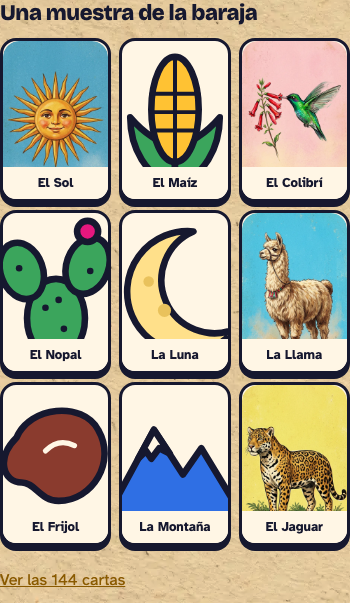
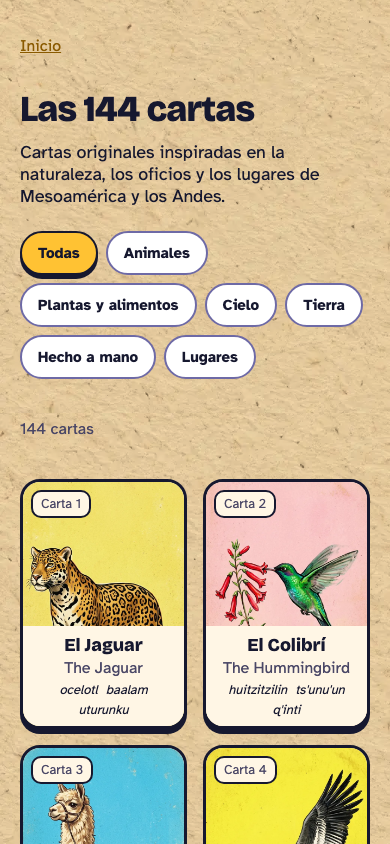
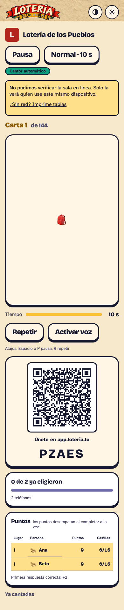
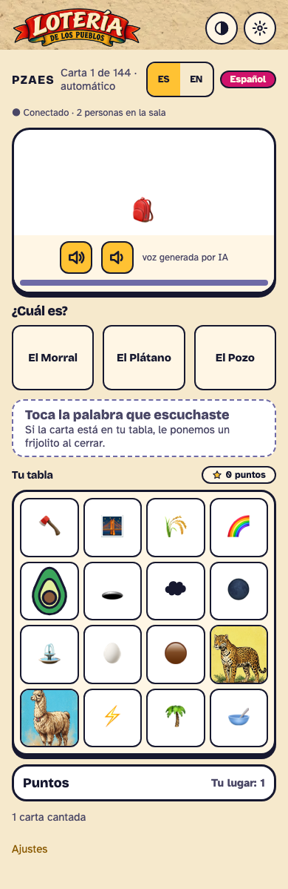
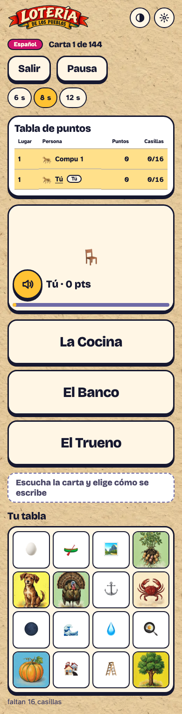

# UX/UI review — 2026-10-27

Reviewed the current local build in Chrome at 390×844, 768×1024, and 1280×900. I checked route content and responsive page bounds, then inspected the branded home and card covers, host, join, solo, print, deck, credits, and shared-settings screens visually. The parchment texture and header banner retain readable foreground cards and text in the sampled light theme. The host/player lobby transitions, live multiplayer board, round completion, and reconnect states are listed from their UI/code paths but need a real second device or service-backed room to review end to end.

Across the sampled routes, the document width matched the viewport at all three widths; I did not observe horizontal page overflow. That does not establish that every control or zoom level is free of clipping.

## Screen inventory

| Route / state | Screen and purpose | Evidence |
| --- | --- | --- |
| `/` | Home/setup: name and avatar, menu and spoken language, create/join/solo actions, then product explanation, FAQ, and catalog sample | Browser observed |
| `/host` | Resume-or-start; host lobby with display/play mode, invite QR/code, roster, game settings, and sticky start area; then cantor game | Lobby observed locally; active cantor state code-inferred |
| `/r/:code` | Two-step join form and spoken-language selection; then waiting room/roster, player board, completion screen, and connection recovery | Join steps observed; multiplayer states code-inferred |
| `/solo` | Solo setup (opponents, difficulty, board size, speed, call language), active game and completion | Setup and active game observed |
| `/print` | Paper-board settings, print code, paper size, label language, large-type/ink options, PDF generation | Browser observed |
| `/deck` | Search/browse surface for all 144 catalog entries with category filters and language names | Browser observed; there is no search control in current UI |
| `/creditos` | Illustration, language provenance, voice, collaborator, and software credits | Browser observed |
| `/ui` | Component/state gallery for design review | Browser observed; intended audience is inferred to be internal |
| `*` | Not-found screen with return-to-home action | Browser observed |
| Shared shell | Theme and language-settings sheets, skip link, route title/head updates | Theme and language sheets observed |

### Current phone screenshots

Captured at 390 px wide. The first shows the home deck sample; the next shows the full catalog card treatment; the remaining images cover the host caller, player board, and solo game.

## Recommendations

### P1 — Keep per-language coverage visible at the point of choice

**Screens:** shared language settings, `/solo`, `/host` setup, and `/deck`. **Observed and data-verified.** The home page now explains that Spanish and English cover all 144 cards and the original 54 are also available in Náhuatl, Maya yucateco, and Quechua. But the language pickers still show five uniformly “available” options without their card counts. A person can understand the home-page note and still lose that distinction later when setting up a room or returning to change languages.

Show the playable-card count next to each spoken-language option and carry it into the host’s frozen deck choice. Keep the distinction visible in the deck filters and in language settings after the first visit.

### P2 — Bring the primary home action into the first phone viewport

**Screen:** `/`. **Observed at 390×844; breakpoint behavior inferred from CSS.** The new 352×119 px brand banner sits above the name, avatar, UI-language controls, and spoken-language choices; “Crear una sala” and the other primary actions remain several groups below the initial viewport. At 768 px the page remains a single column because the two-column layout starts at 1024 px; at 1280 px the two-column layout is visible.

Keep the default path short: put “Crear una sala” near the name field and move less frequently changed language preferences into an expandable or secondary settings step. Retain a clear way to set the spoken language before creating a room. Consider using the secondary column from the 768 px tablet breakpoint so the instructional content does not lengthen the setup path.

### P2 — Keep the host’s sticky start bar from covering invite content

**Screen:** `/host` lobby. **Observed at 390×844; implementation confirmed.** In the phone view, the sticky “Empezar” area and its top border sit across the lower edge of the QR/invite card, visually cutting through the card while the roster and settings continue below. The bar uses sticky positioning in `src/app/host/HostLobby.module.css`.

Reserve enough scroll space and safe-area padding for the bar, and verify the QR/code card remains fully readable when the bar is stuck. Keep the “at least two people” reason visible with the disabled action. At wider viewports, recheck that the sticky action remains visually attached to the relevant roster/settings rather than spanning unrelated content.

### P2 — Make the 144-card catalog faster to scan

**Screen:** `/deck`. **Observed at 390×844.** The current page provides category chips and a result count, but no text search. After compacting the language labels, the measured page height is about 19,749 px at 390 px; each card repeats its number, Spanish/English names, and language entries. Category filtering helps, but finding one named card still requires scanning or browser find through a long document.

Add a labeled search for card number and available names, preserve category filtering, and announce the filtered count. If rendering all entries remains slow on lower-end phones, progressively render or paginate while retaining keyboard and screen-reader access. Show missing language coverage explicitly rather than leaving users to infer it from absent labels.

### P1 — Ensure every playable card has full-cover artwork (fixed after the screenshots)

**Screens:** host caller, player call, solo call, and `/deck`. **Historical observation:** when these screenshots were captured, the asset index had 111/144 raster covers and 33 cards used a small centered SVG/emoji fallback; the saved host and player images show that earlier state. **Current release state:** all 144 covers are now present and reviewed. The files total 4,324,088 bytes and the generated unique PWA precache is 9,255,794 bytes, within budget. The screenshot evidence records the earlier finding and should not be read as current asset coverage.

Keep the release check asserting a valid raster image for every active card, and retain a visible fallback for network failure.

### P2 — Keep full-cover artwork visible around its captions

**Screens:** `/deck` and home sample strip. **Observed at 390×844.** The new cover treatment makes the cards more distinctive and the two-column catalog easier to browse. The opaque caption still occupies roughly 40–49% of the portrait face on dense cards, so the cover is visually reduced to its top half. The home sample is more image-led and uses a consistent caption strip.

Keep all labels and language metadata, but use a shorter caption region on the catalog cards—especially for the three secondary-language labels—so more of each illustration remains visible. Preserve wrapping and test long names; do not shrink text until it becomes hard to read.

### P2 — Shorten the print setup path on phones

**Screen:** `/print`. **Observed at 390×844.** The generated print code panel precedes quantity, paper size, label language, and print options. In the first phone viewport the user reaches only the start of the options; “Crear PDF” is lower on the page, after a long configuration form.

Make the code panel collapsible after the user copies or notes the code, and keep the configured “Crear PDF” action reachable without scrolling back through the entire form. Test the action with the mobile browser’s native PDF/download flow and preserve the selected values if the user returns from printing.

### P2 — Preserve readable score summaries on narrow screens

**Screens:** `/solo` active game and `/r/:code` player game. **Observed in solo at 390×844; player behavior inferred from shared board implementation.** The solo score table compresses four columns (“Lugar”, “Persona”, “Puntos”, “Casillas”) into the narrow game column; its headers and values become markedly smaller than the surrounding controls. The call, three answer buttons, and player tabla also form a page taller than the phone viewport, so the board is reached by scrolling.

At phone widths, present each player’s score as a compact stacked row/card or prioritize name, points, and progress while keeping the complete table available on demand. Preserve the call and answer choices as the immediate task; make the location of the player tabla and the need to scroll obvious. Verify the same layout with long names and 8×8 tables.

### P3 — Treat the join form as a quick entry path

**Screen:** `/r/:code` join flow. **Observed.** Joining takes two steps: name/avatar/optional pronouns, followed by language choice. The optional pronouns field is shown alongside required identity choices, so it competes for attention even though it is not needed to get into a room.

Visually separate or collapse pronouns under an “optional” disclosure, keep a clear “skip” path, and explain that the name is visible in the room before submission. Preserve the step count and selected language when returning to step one.

### P3 — Structure credits around language and coverage

**Screen:** `/creditos`. **Observed.** Provenance and license details are concentrated into a long paragraph that mixes three language families, two voice systems, review status, orthography, and non-commercial terms. This is difficult to scan on a phone and makes it hard to connect a language option with its coverage and voice.

Break this into per-language sections with separate “names and review” and “voice/license” fields. Link the section back to the language picker or deck filter. Keep unresolved-source language explicit, and avoid presenting reference families as confirmed per-card citations.

### P3 — Keep the component gallery out of the player journey

**Screen:** `/ui`. **Observed route; production exposure and audience are inferred.** The route renders development component examples and is directly reachable in the production router, but it is not linked from normal navigation.

If this remains an internal review surface, gate it to development or exclude it from indexing; otherwise label it clearly as a component gallery and provide a home link.

## Verified integration findings from the final review

### P1 — Keep paper boards inside their selected language coverage (BUG-017, fixed)

**Screen:** `/print` PDF output. **Historical reproduction:** the earlier builder dealt all 144 cards for every label language and silently substituted Spanish for expansion cards. The final implementation now deals from the selected language's available pool: 144 cards in Spanish/English and 54 in each Indigenous language. Regression tests cover all five pools and verify every generated label. The PDF also embeds the available WebP card covers; PDF image embedding and native labels passed the final suite.

### P1 — Preserve a changed spoken language when a phone reloads (BUG-018, fixed)

**Screen:** `/r/:code` active player. **Historical reproduction:** after changing from Náhuatl to English, a reload restored the initial join voice. The final flow restores the latest supported language; end-to-end checks at phone, tablet and desktop confirmed the selected voice, board image order, crosses and points survive reload.

### Confirmed room-deck invariants

The actual Spanish/English catalog dealt twenty unique 8×8 tablas for the review seed, each with 64 cells and no pair sharing more than 32 cards. Current playable coverage is es/en 144 and nah/yua/quz 54. Frozen-deck, late incompatible-language fallback, header/settings constraints and legacy 54-card restoration have automated integration coverage. A prior production Supabase smoke also advanced calls across three isolated browser contexts; it preceded the pending 144-card release and does not certify the new release.

## Recheck after changes

Repeat the 390×844, 768×1024, and 1280×900 pass after the coverage labels and layout adjustments. Include keyboard-only navigation, 200% zoom/text spacing, 360 px width, and the service-backed join → lobby → player → completion → reconnect path; those checks were not established by this review.
